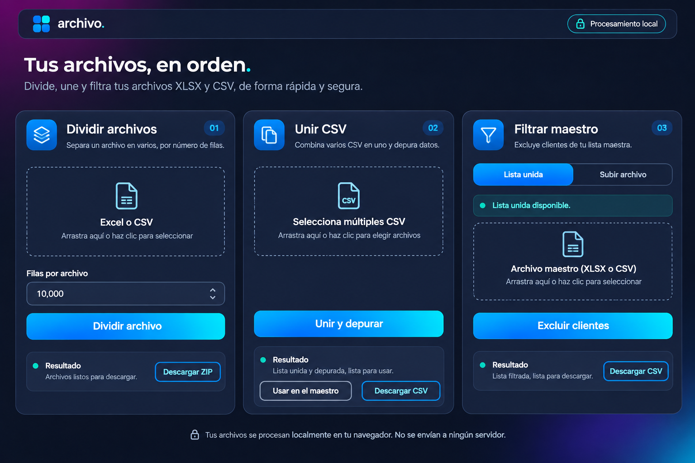

# Referencia del dashboard

Mockup creado con la herramienta integrada ImageGen a partir de la direccion visual solicitada: azul noche, acentos electricos y tres modulos en cards, sin sidebar.

La implementacion usa HTML, CSS y SVG. La imagen es una referencia de diseno y no se carga al abrir la herramienta.

## Sistema visual implementado

- Fondo `#101523`, cards `#1b243c`, texto `#f4f7ff` y texto secundario `#adbcd4`.
- Acentos `#168eff` y `#05c7e5`. Botones luminosos con texto oscuro para mantener el contraste.
- Cards de 22 px de radio, controles de 10 px y espacios de 8/16/24 px.
- Tres columnas en escritorio, dos mas maestro centrado con el mismo ancho en tablet y una columna en movil.
- En escritorio las cards comparten altura y alinean acciones y resultados. El panel de resultados tiene altura uniforme y permite desplazar su contenido, sin agrandar una sola card. En movil la altura se adapta al contenido.
- Todos los modulos permanecen visibles. Los enlaces entre cards mueven el foco y desplazan la pagina solo cuando hace falta.
- Sin desenfoques, capas decorativas fijas ni animaciones de entrada.

## Skill consultada

[UI/UX Pro Max](https://github.com/nextlevelbuilder/ui-ux-pro-max-skill/blob/main/.claude/skills/ui-ux-pro-max/SKILL.md).

Se consulto el generador con `data utility dashboard dark --design-system --variance 6 --density 8 --motion 1`. La recomendacion de landing empresarial no correspondia al producto; se afino con `dark dashboard --domain style`, que devolvio `dark-mode-oled`. Se aplicaron sus pautas de contraste, foco visible y efectos contenidos, junto con el mockup y la referencia del usuario.

## Prompt de ImageGen

Use case: ui-mockup. Create a polished high fidelity desktop web application mockup, 1536px landscape composition, Spanish language. Product 'archivo.' local XLSX and CSV data utility. Visual reference described: elegant midnight navy dashboard with rounded dark blue cards, vivid electric blue to cyan gradient primary buttons, subtle magenta and indigo ambient corner illumination on page background. No sidebar, no vertical navigation, no big marketing hero, NO charts or fake metrics. Compact horizontal top bar with archive four-square logo and 'archivo.' at left, small lock badge 'Procesamiento local' at right. Short heading 'Tus archivos, en orden.' with very short subtext. The THREE functional modules must all appear simultaneously as three equally wide beautiful dark navy cards side-by-side, top aligned, spacious but usable with compact proportions. Card 1 title 'Dividir archivos', small blue icon in rounded square and badge '01', one compact file upload zone with document icon and text 'Excel o CSV', labeled numeric input 'Filas por archivo', wide bright blue gradient primary button 'Dividir archivo', small results area at bottom with 'Descargar ZIP'. Card 2 'Unir CSV', badge '02', file upload for multiple CSV, primary button 'Unir y depurar', compact result area, two smaller controls 'Usar en el maestro' and 'Descargar CSV'. Card 3 'Filtrar maestro', badge '03', segmented selector 'Lista unida' and 'Subir archivo', subtle cyan list availability callout, compact master file upload zone, blue primary button 'Excluir clientes', bottom result download. Retain legible light gray body text and clean modern sans-serif typography, 20px card corners, thin navy borders, small accent dots, professional accessible contrast, generous aligned gutters. Footer understated lock privacy note. Realistic production interface, avoid excessive text, no arrows attached to buttons. Flat straight-on UI screenshot, NOT photographed monitor, no device frame, no perspective. Background page #101524, cards #1a233d, accent #079aff. Overall composition closely resembles a refined dark dashboard component collection but must form a usable single screen with all three tool cards.
